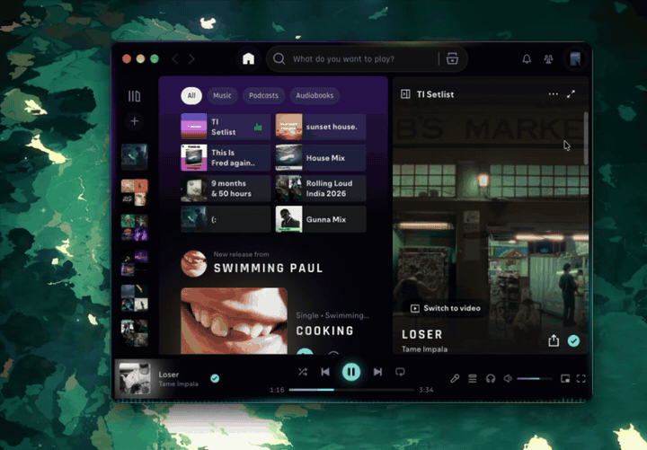
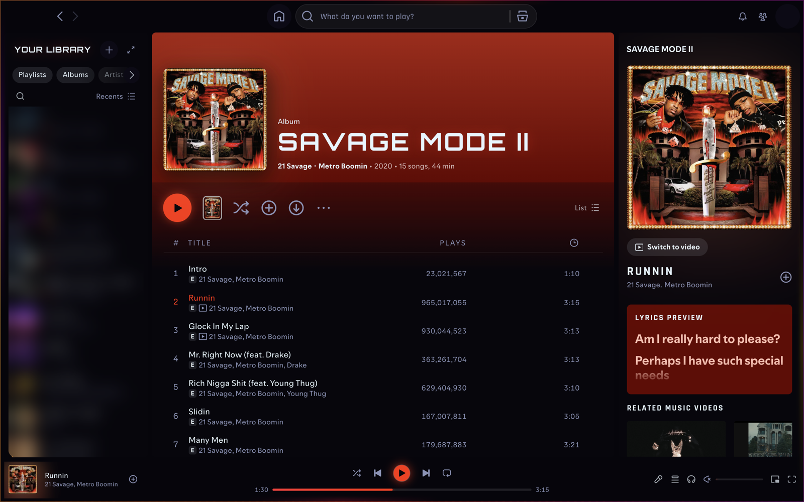

# Ambient Cyber — a music-reactive Spotify theme

A [Spicetify](https://spicetify.app) theme and extension that turns the Spotify desktop app into a clean, neon, cyberpunk-styled player **whose lights move with the music**. On macOS, an optional companion app lets the glow spill out of the window onto your desktop.





*Top: the theme running as a window, with the glow spilling onto the desktop. Bottom: an album page, with accents taken from the cover art.*

## Highlights

- **Beat-synced lighting** without access to the audio stream: the lights follow Spotify's own beat, bar and loudness timeline, lined up with the playback position on every animation frame
- **Colours from the album art:** each track's cover is sampled, grouped by hue and boosted into a neon palette that the whole UI uses
- **Light that leaves the window:** a native macOS companion app (Swift, Core Animation) paints a click-through glow on the desktop behind Spotify, in sync with the in-app lights
- **Safe by design:** the desktop glow can only draw outside the Spotify window, hides when there's no room for it, and only listens on localhost

**Built with:** JavaScript (Spicetify extension, Canvas 2D), CSS (Spicetify theme), Swift (AppKit, Core Animation, Network framework), shell and Python tooling.

## Features

**Theme**
- Deep, near-black UI with soft rounded panels, cards and track rows
- Orbitron display titles and Rajdhani UI text (bundled, no network fonts)
- Accent colour (play buttons, progress bar, selection) follows the current album art, boosted to neon

**Edge lights (synced to the music)**
- A hairline neon line around the window edge, with the album's colours slowly circling
- Light streaks that travel around the edge, speeding up when the song gets louder
- A whole-edge flash on every beat, stronger on each bar's downbeat, cycling through the palette
- Subtle EQ-style bars along the bottom edge, driven by the song's pitch and loudness

**Cover glow**
- Album art glows in its own colours (now-playing cover, large covers, hovered cards) and pulses on the beat

**Desktop glow (macOS, optional)**
- A small click-through companion app paints a soft, drifting glow *outside* the Spotify window, in sync with the in-app lights
- Follows the window as you move/resize it; hides when Spotify is full-screen, minimised or on another desktop

## How the sync works

Spotify doesn't expose its raw audio to extensions. Instead, the extension reads Spotify's own per-track audio analysis (beat, bar and segment timings with pitch and loudness) through Spicetify, and lines it up with the playback position every animation frame. Album colours are sampled from the cover art.

The desktop glow app receives the palette and beat timeline from the extension over `http://127.0.0.1:47823` (localhost only) and runs the same timing locally.

## Requirements

- Spotify desktop app
- [Spicetify](https://spicetify.app) (`brew install spicetify-cli` on macOS)
- Python 3 (to build the theme CSS)
- For the desktop glow: macOS 13+ and the Xcode Command Line Tools (`xcode-select --install`)

## Install

```bash
git clone https://github.com/xsheel/spicetify-ambient-cyber.git
cd spicetify-ambient-cyber
./scripts/install.sh              # theme + edge lights + cover glow
./scripts/install.sh --with-glow  # …plus the macOS desktop glow app (starts at login)
```

On macOS, Spicetify needs permission to modify the Spotify app: **System Settings → Privacy & Security → App Management** → enable your terminal app.

**Windows / manual install:** run `python3 scripts/build-theme.py`, copy `theme/Ambient/` into Spicetify's `Themes` folder and `extension/ambient-edge.js` into its `Extensions` folder (`spicetify config-dir` opens it), then:

```bash
spicetify config current_theme Ambient color_scheme Base inject_css 1 replace_colors 1 extensions ambient-edge.js
spicetify apply
```

The theme and in-app lights work on every platform Spicetify supports. The desktop glow app is macOS-only.

After a Spotify update removes the theme, run `spicetify backup apply`.

## Uninstall

```bash
./scripts/uninstall.sh
```

This stops and removes the desktop glow app, deletes the theme and extension, and runs `spicetify restore` to return Spotify to stock.

## Customising

| What | Where |
| --- | --- |
| Colours | `theme/Ambient/color.ini`, and the `--neon-*` variables at the top of `user.src.css` |
| Layout, fonts, rounding | `theme/Ambient/user.src.css` (run `scripts/build-theme.py` after editing) |
| Beat timing offset | `LATENCY` at the top of `extension/ambient-edge.js` |
| Bar size and brightness | `BAR_H` and the bar section in `extension/ambient-edge.js` |
| Desktop glow reach | `MARGIN` in `glow-app/main.swift` |

## Project layout

```
theme/Ambient/      Spicetify theme (color.ini, user.src.css, bundled fonts)
extension/          ambient-edge.js: edge lights, EQ bars, cover glow, desktop-glow bridge
glow-app/           Swift source for the macOS desktop glow app
scripts/            build, install and uninstall scripts
```

## Troubleshooting

| Problem | Fix |
| --- | --- |
| Theme disappeared after a Spotify update | `spicetify backup apply` (if it complains about the backup: `spicetify restore backup apply`) |
| "Cannot write to Spotify's application files" (macOS) | Allow your terminal under **System Settings → Privacy & Security → App Management** |
| Flashes feel slightly early or late | Change `LATENCY` at the top of `extension/ambient-edge.js` (e.g. `0.08`), then `./scripts/install.sh` |
| No desktop glow | Spotify must be a normal window with some desktop around it (not full screen). Check the app is running: `launchctl print gui/$(id -u)/local.ambient.glow` |
| Stop the desktop glow for now | `launchctl bootout gui/$(id -u)/local.ambient.glow` |

## Limitations

- The beat sync relies on Spotify's audio-analysis data, read through Spicetify. Spotify has restricted its public audio-analysis API, so if this data becomes unavailable the lights fall back to a gentle generic pulse (the theme and colours still work).
- Spotify's internal class names change between releases, so an update can occasionally un-style a part of the UI until the theme is adjusted.
- Podcasts and local files have no analysis data and use the fallback pulse.

## Credits and licence

- Code: MIT, see [LICENSE](LICENSE)
- Fonts: [Orbitron](https://github.com/theleagueof/orbitron) and [Rajdhani](https://fonts.google.com/specimen/Rajdhani), SIL Open Font License 1.1 (licence texts in `theme/Ambient/fonts/`)
- Built on [Spicetify](https://spicetify.app)

This is an unofficial personal project and is not affiliated with or endorsed by Spotify. Modifying the Spotify client is not officially supported; use at your own risk.
